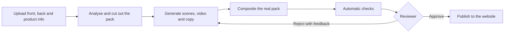

# Shelf Studio

Shelf Studio turns one product photo into approved, retailer-ready images, video and copy for Amazon, Walmart, Target and verda.com.

Two rules shape everything in it:

- **It generates the scene, never the product.** Still images carry the real packshot's pixels, composited on top of a generated background. A check measures the pixels against the approved cutout.
- **Nothing ships without a person.** Every asset goes through automatic checks and then a reviewer before it can be published.

## How it works



1. **Add a product.** Upload the front and back images, plus product information as a file (PDF, TXT, CSV, TSV, JSON or Markdown) or pasted text. Claude reads it into fields, and a person confirms them before they're saved. This product database is the source of truth for all copy.
2. **Generate.** Pick one channel or all of them, with a credit estimate up front. Assets run in parallel within the Runway account's live rate limits, and channels with the same ratio share a scene.
3. **Write copy.** An AI SDK agent loads the channel's skill, drafts the listing, validates it, fixes what fails and saves it. Generating a channel starts this automatically.
4. **Refine.** Change a background, add text or edit the video. Every edit creates a new version, and earlier versions stay on record.
5. **Check.** Pixels, specs and fill are measured in code. Style and legal rules are judged by vision review. Text drawn by a model is read back and compared word by word.
6. **Review.** A reviewer approves or rejects with feedback, and can have the agent regenerate from that feedback.
7. **Publish.** Approved assets go live on the sample website at `/verda`. Marketplaces, Salsify and DAM are shown as not connected.

The product page previews each channel as a retailer-style page, so you can see how the images and copy look together before review. The Model lab at `/lab` compares models on a saved prompt library, without touching real assets.

## Signing in

The app and its API sit behind one shared demo account. The sample website at `/verda` stays public, because it only shows published assets. The username and password come from environment variables and are never stored in the repo.

The header's switcher changes between three demo roles, all available to anyone signed in:

| Role | Can do |
|---|---|
| Producer | Generate, refine, submit and publish |
| Reviewer | Approve and reject |
| Owner | Everything a producer can, plus change settings |

## Models

| Job | Model | Credits |
|---|---|---|
| Lifestyle and in-use scenes, 2K | `nano_banana_2.1` | 6 each |
| Text in images | `gpt_image_2_5_sunburst` at max quality | 63 each, 64 with a reference image |
| Text in images, exact lettering drawn by code | None | 0 |
| Main image | None, the real packshot on white | 0 |
| Cutout mask, once per product | `gemini_image3.1_flash` | 11 |
| Video, 5 s at 1080p | `seedance2_5` | 340 |
| Video edit, 5 s | `aleph2` | 140 |
| Analysis, copy and vision checks | `claude-opus-5-5` | Claude tokens |

All channels for one product cost about 75 credits in images, plus 340 for each video. Earlier model research is in [`docs/RESEARCH.md`](docs/RESEARCH.md). The table above shows what's in use today.

## Run it locally

You need Node 22 or later, a Supabase project, a Runway API key and an Anthropic API key.

```bash
npm install
cp .env.example .env.local
```

Fill in `.env.local`, then apply `supabase/migrations/*` to your Supabase project.

```bash
npm run seed
npm run dev
```

Open http://localhost:3000 and sign in with `DEMO_USERNAME` and `DEMO_PASSWORD`.

`npm run seed` loads the SKU sheet, channel specs, style guide, legal rules and eval prompts. It also resets `shot_templates` to the values in the seed script.

Checks: `npm test`, `npm run lint` and `npm run build`.

## Deploy to Vercel

Set these for the Production environment, then deploy:

| Variable | Purpose |
|---|---|
| `NEXT_PUBLIC_SUPABASE_URL` | Supabase project URL |
| `SUPABASE_SECRET_KEY` | Server-only database access, which bypasses Row Level Security |
| `RUNWAYML_API_SECRET` | Image and video generation |
| `ANTHROPIC_API_KEY` | Analysis, copy and checks |
| `RUNWAY_CREDIT_CAP_PER_RUN` | Stops a channel run from overspending |
| `DEMO_USERNAME`, `DEMO_PASSWORD` | The demo account |
| `AUTH_SECRET` | Signs session cookies. Changing it signs everyone out |
| `CRON_SECRET` | Optional, for a scheduled pipeline tick |

```bash
vercel deploy --prod
```

The open page drives the pipeline, so runs pause when nobody has it open. To keep them moving, schedule `GET /api/pipeline/tick` with `CRON_SECRET`. Frequent crons need a paid Vercel plan.

## Architecture

| Area | Where | Notes |
|---|---|---|
| Sign-in | `src/proxy.ts`, `src/lib/auth/` | A signed session cookie, checked on every request |
| Pipeline | `src/lib/pipeline/tick.ts` | One idempotent step, safe to call concurrently, so no long-lived process is needed |
| State machine | `src/lib/domain/` | Pure and tested: transitions, failure policy, permissions and next steps |
| Compositing | `src/lib/pipeline/compose.ts` | Real cutout on the scene, shadows and exact channel encoding |
| Agent | `src/lib/agent/` | AI SDK `ToolLoopAgent`, channel skills in Markdown and validators in code |
| Checks | `src/lib/pipeline/checks.ts` | Measured checks plus vision review |
| Evaluation | `src/lib/eval/`, `/lab` | Scored comparisons of image, text, video, copy, analysis and cutout models |
| Data | `supabase/migrations/` | Shot lists and channel specs are rows, so a new SKU or retailer needs no code |
| Website | `src/app/(site)/` | Only shows published assets |

**Stack:** Next.js 16, AI SDK 7, Claude, Runway, Supabase, sharp and Tailwind 4.

**Rate limits:** concurrency and daily limits are read from Runway's organization endpoint. Dispatch stays under them, `THROTTLED` responses and 429s show as queued, and retries follow Runway's failure codes with backoff.

## Known limits

This is a demo, not a production system.

- **One shared account.** Roles are a switcher, so they show the workflow but don't enforce who can do what. Real use needs individual accounts.
- **Real money behind the login.** Anyone signed in can spend Runway credits and Claude tokens. `RUNWAY_CREDIT_CAP_PER_RUN` covers channel runs, but not one-off videos and refinements.
- **Public storage.** Generated images use unguessable but public URLs, including unapproved ones.
- **Video can't fully keep the product real.** An orbit shot makes the model draw parts of the pack, so labels can drift. Reviewers always check video.
- **Channel limits** come from third-party summaries. Check them against Seller Central and each retailer's docs.
- **Legal rules are starting defaults**, not legal advice. Your legal team should replace them in Settings.
