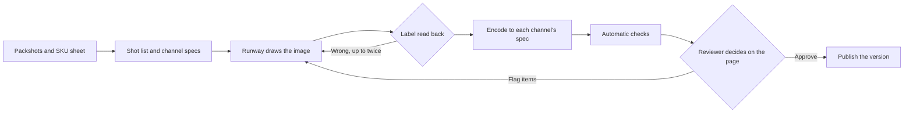

# Shelf Studio

Shelf Studio takes VERDA's front and back packshots and a SKU sheet, and produces PDP-ready images, video and copy for each channel on the Runway API. Everything gets automatic checks, and a person approves each page before it goes live.

- **App:** https://shelf-studio-ochre.vercel.app (sign-in details are shared separately)
- **Sample website, showing only published pages:** https://shelf-studio-ochre.vercel.app/verda
- **Generated outputs, by channel:** [`outputs/`](outputs/)
- **Everything else, including models, PDP states and deployment:** [`docs/GUIDE.md`](docs/GUIDE.md)

## What it makes

The shot list and channel specs are data, so a new SKU is a new row and two images, with no code changes. VRD-1001, VRD-1002 and VRD-1003 have all run through the app this way.

| Shot | How it's made | Amazon | Walmart | Target | verda.com |
|---|---|---|---|---|---|
| Main image | Real packshot on white, no model | 2000 × 2000 | 2200 × 2200 | 2400 × 2400 | 2000 × 2000 |
| Lifestyle | Model draws it from the packshots | 2000 × 2000 | 2200 × 2200 | 2400 × 2400 | 2400 × 1340 |
| In-use | Model draws it from the packshots | 2000 × 2000 | 2200 × 2200 | 2400 × 2400 | 2000 × 2000 |
| Claim card | Model draws it, copying a type reference | 2000 × 2000 | 2200 × 2200 | 2400 × 2400 | 2000 × 2000 |
| Video | Image to video, from the Lifestyle image | 1080 × 1920 | 1080 × 1920 | 1080 × 1920 | 1920 × 1080 |
| Listing copy | Agent, from approved product data | Each channel's rules | Each channel's rules | Each channel's rules | Each channel's rules |

- **Shot list:** [`supabase/seed-assets/shot-templates.json`](supabase/seed-assets/shot-templates.json), with each shot's model and prompt
- **Channel specs:** [`scripts/seed.mjs`](scripts/seed.mjs), loaded into the `channel_specs` table
- **SKUs:** [`supabase/seed-assets/product-sheet.json`](supabase/seed-assets/product-sheet.json) and [`supabase/seed-assets/catalog/`](supabase/seed-assets/catalog/)

## Run it

You need Node 22 or later, a Supabase project, a Runway API key and an Anthropic API key.

```bash
npm install
cp .env.example .env.local
```

Fill in `.env.local`, then apply `supabase/migrations/*` to your Supabase project.

```bash
npm run seed
npm run catalog
npm run dev
```

Open http://localhost:3000, sign in with `DEMO_USERNAME` and `DEMO_PASSWORD`, open a product and press **Create**.

`npm test` runs the tests, and `npm run export` writes the current outputs to `outputs/`.

## Architecture

A Next.js app holds the workflow, Supabase holds the state and files, Runway makes images and video, and Claude writes prompts and copy and checks the results. There's no long-running worker. `tick()` in [`src/lib/pipeline/tick.ts`](src/lib/pipeline/tick.ts) moves every job one step and is safe to call concurrently, so an open browser tab or a cron job can drive it. It stays within Runway's live rate limits and retries by failure code. The rules for moving between states are pure, tested functions in [`src/lib/domain/`](src/lib/domain/).



## Credits consumed

These are the totals as of November 4, 2026.

| Spend | Credits |
|---|---|
| VRD-1001, including earlier attempts and every channel | 618 |
| VRD-1002 | 537 |
| VRD-1003 | 158 |
| An early test product, since hidden | 362 |
| Evals | 899 |
| Model tests run outside the app | About 1,490 |
| **Total** | **About 4,060** |

One product now costs about 55 credits in images for all its channels, plus 85 for each video and 18 or 19 for each label that has to be redrawn. Cutouts add 7 credits per product, which the app's totals leave out.

## Fidelity and review

The product must never be wrong, so the question is where wrong can get in, and what catches it.

**The main tradeoff.** I started by compositing the real cutout onto generated scenes. That guarantees every pixel of the pack, but it looked pasted in, however good the blending, and a composited bottle can't get wet. So Lifestyle, In-use and claim cards now have a model draw the whole image from the packshots. They look far better, but the pack is no longer the approved pixels, so a label can be wrong. That risk is accepted only because of the checks below. Any Lifestyle or In-use image can still be switched back to compositing.

**Choosing models by test.** I tested on labels rather than on looks:

- **Images:** GPT Image 2.5 Sunburst got the label right on all 29 test images, across all 5 products. Nano Banana 2.1, Nano Banana Pro and Seedream 5.0 Pro each misspelled the small print when compared on one product.
- **Video:** on one start frame, Kling O3 Pro and Kling 4 kept small print clean, Seedance 2.5 softened it, and Veo 3.1 garbled it ("480 mL"). This is the thinnest evidence here.

**What protects each shot:**

| Layer | Main image | Lifestyle, In-use, claim card | Video |
|---|---|---|---|
| Real pixels | Yes, compared with the approved cutout | No | No |
| Reference images | Not needed | Front and back packshots | Starts from a checked Lifestyle image |
| Label read back and compared word by word | Not needed | Yes, redrawn up to twice, then blocked | Not automated |
| Shape and colour measured | Not needed | Yes, warns only | No |
| Channel spec checks | Yes | Yes | No |
| Style and legal vision review | Yes | Yes | No |
| Reviewer told to check it | Only if a check warns | Always | Always |

**What these checks don't do:**

- The read-back is itself a model, so it can be wrong. It has flagged correct labels, which cost one needless redraw, and it could in principle miss an error. That's why a person always looks at a drawn pack.
- Shape and colour are approximate, so they only warn.
- The app doesn't check video frames, because they can't be decoded on serverless. I only checked them offline in the test, so video depends on the reviewer.

**How a person accepts, rejects or regenerates.** Approval is for the whole page, not each asset, so a live page is never half old and half new.

1. A producer submits a PDP version, which freezes it. A failed check blocks this.
2. A reviewer sees it as one page, and confirms each flagged check.
3. To accept, they approve, and a producer publishes the version as a set. Any earlier live version can be restored.
4. To reject, they flag items with a note. The next version regenerates only those items, using the notes, and reuses the rest.

Producers can also regenerate or refine any item before submitting. If a drawn label keeps failing, they can switch that image to the real pack blended into a scene, or a claim card to exact lettering.

## Outputs

[`outputs/<SKU>/<channel>/`](outputs/) holds each product's current assets, as they are. Each channel's `manifest.json` records the model, prompt, label result, credits and check results for each asset, and which PDP versions exist. A draft there hasn't been approved.
